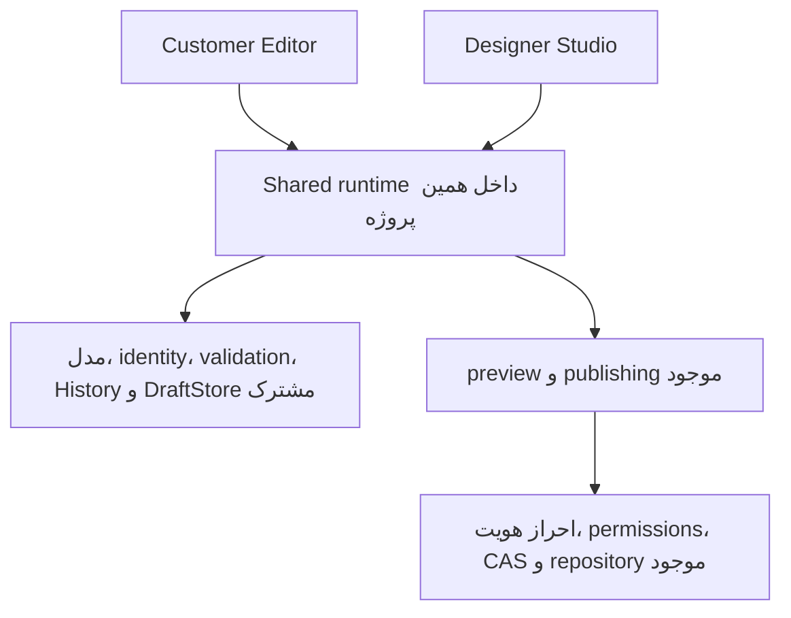

# Task 18 — Customer Editor و Designer Studio

تاریخ: ۲۰۲۶-۱۰-۲۱. شاخهٔ محلی: `codex/task18-customer-editor`.

**پیاده‌سازی و QA محلی: PASS. آمادگی تأیید نهایی تولید: PARTIAL.** همهٔ مسیرهای درخواست‌شده در محیط ایزوله اجرا شدند. تحقیق کاربردپذیری انسانی و آزمایش روی گوشی فیزیکی انجام نشده است؛ هیچ انتشار تولیدی در دامنهٔ این کار نبود.

## مبنا و Git

- مبنا، آخرین `origin/main` دریافت‌شده: `d813670e50316f2fd830e05c4fe5ab8c1019e9f3`.
- وجود اصلاح Task 17، یعنی `b3868c9`، در ancestry مبنا بررسی شد؛ merge مربوط به آن و حذف canary نهایی در main موجود بودند.
- commit کد و آزمون‌های این کار: `94f1744658aefbbb849f216266215861ca40d847`.
- چهار سند درخواستی ممیزی، inventory، معماری و roadmap بررسی شدند. پنج فایل موجود Task16 شامل JSON inventory خارج از commit این کار و بدون تغییر باقی ماندند.
- هیچ Push، merge، Deploy یا نوشتن محتوای تولید انجام نشد. استخراج `CMS_CORE` انجام نشد.

## نتیجه به تفکیک الزام

|بخش|وضعیت|نتیجه|
|---|---|---|
|Customer Editor مستقل|PASS|ورودی و HTML/CSS مستقل، انتخاب روی سایت واقعی، رابط فارسی RTL، محتوای انگلیسی LTR، فرم‌ها و گالری مناسب لمس|
|Designer Studio|PASS|Builder قبلی و امکاناتش محفوظ؛ ۱۶ بلوک، Free/Flow، responsive، لایه‌ها، گروه‌بندی، قفل، typography و تنظیمات پیشرفته آزمایش شدند|
|موتور مشترک|PASS|مدل V2، migration و draftهای V1/V2، identity، History، اعتبارسنجی، ذخیره، renderer، preview و publisher مشترک|
|مجوز سمت سرور|PASS|Studio فقط برای نقش موجود admin؛ editor برای محتوا و پیش‌نویس؛ انتشار و طراحی حرفه‌ای با درخواست جعلی دور زده نمی‌شوند|
|مسیرهای مشتری و recovery|PASS|عنوان، تصویر کتابخانه/دستگاه، محصول، تماس، ساخت صفحه، preview، انتشار محلی، undo/redo، خطای ذخیره و بازیابی پشتیبان|
|PWA و صفحات فعلی|PASS|manifest و نصب آنلاین محفوظ؛ بدون کش خصوصی یا service worker تازه؛ هر نه صفحهٔ اصلی بدون تغییر|
|پذیرش انسانی و گوشی واقعی|PARTIAL|۰ شرکت‌کنندهٔ انسانی؛ دستگاه فیزیکی آزمایش نشد؛ موفقیت automation به‌عنوان تأیید کاربردپذیری انسان اعلام نمی‌شود|
|استقرار واقعی نسخهٔ جدید|انجام نشده|طبق دستور، صرفاً build dry-run و runtime جداشده اجرا شد|

## معماری اجرایی B

`/admin/editor/` تجربهٔ مستقل مشتری است. `/admin/builder/` تجربهٔ حرفه‌ای باقی مانده است. کد runtime موجود از ورودی Builder به `public/admin/builder/runtime.js` منتقل شده؛ ورودی قبلی آن را import می‌کند. هر دو تجربه همان runtime را اجرا می‌کنند و controllerهای حرفه‌ای فقط در Studio نصب می‌شوند.

صفحه و عناصر، schema یا فرمت انتشار دوم ندارند. کلیدهای پیش‌نویس صفحه، همان DB `baran-visual-builder` و همان `user:path` هستند؛ بنابراین تغییر، undo و redo میان مشتری و Studio مشترک‌اند. تست مرورگر، نام محصول را در Customer تغییر داد، در Studio دوباره ویرایش کرد و سپس در Customer همان identity و افزایش درست تاریخچه را تأیید کرد.

رابط مشتری یک adapter کوچک برای bindingهای DOM runtime فعلی دارد. bindingهای داخلی inert و پنهان‌اند؛ panel و controller حرفه‌ای در این تجربه ساخته نمی‌شوند. این راه‌حل جداسازی presentation درون همین پروژه است؛ ادعای engine کاملاً مستقل از DOM یا package عمومی استخراج‌شده ندارد.

تماس از DTO و API موجود `readContacts/applyContacts` استفاده می‌کند. پیش‌نمایش تماس جدید، همان تبدیل امن را بدون commit اجرا می‌کند. پیش‌نویس تماس از همان History و DraftStore استفاده می‌کند و base head، پشتیبان و تاریخچه دارد. پیش‌نویس‌های قدیمی CMS در DB قدیمی حذف یا تبدیل اجباری نشده‌اند؛ پیوند «پیش‌نویس‌های ویرایشگر قبلی» مسیر دسترسی به آن‌ها را نگه می‌دارد.

## آنچه مشتری می‌بیند

نوار کوتاه، ذخیره، انتشار و واگرد/بازانجام را دارد؛ preview جدا و همیشه قابل مشاهده است. منوی «کارها» شامل ویرایش سایت، صفحات، محصولات، تصاویر، تماس، پیش‌نمایش و انتشار است. لمس نوشته/تصویر روی iframe واقعی، فقط sheet محتوای همان مورد را باز می‌کند. انتخاب از فهرست نوشته‌ها و تصاویر هم برای دسترسی با صفحه‌کلید وجود دارد. در این تجربه دستگیرهٔ جابه‌جایی، تغییر اندازه، مختصات، CSS یا ابزار طراحی نمایش داده نمی‌شود.

تصاویر thumbnail و جست‌وجو دارند. بارگذاری دستگاه از optimizer و اعتبارسنجی باینری مشترک استفاده می‌کند. WebKit روی ویندوز برای فایل WebP معتبر MIME خالی تحویل داد؛ fallback اکنون پس از تأیید کامل باینری، MIME معتبر را به decoder می‌دهد. MIME اعلام‌شدهٔ ناسازگار و فایل جعلی همچنان رد می‌شوند.

فرم محصول نام، معرفی، قیمت و تصویر را جلو می‌گذارد؛ مشخصات دیگر با بازکردن جزئیات دیده می‌شوند. نام و تصویر همان محصول در همان model صفحه و history تغییر می‌کنند. متن وضعیت ذخیره و پشتیبان در این فرم هم در دسترس است. کاتالوگ انگلیسی فعلی PDFمحور است؛ رابط به‌جای ساخت محصول فرضی، ویرایش خود کاتالوگ را پیشنهاد می‌کند.

صفحهٔ ساده با عنوان، زبان و متن معرفی ساخته می‌شود. آدرس انگلیسی از عنوان فارسی/انگلیسی پیشنهاد می‌شود و قابل تغییر است؛ سرور همچنان آدرس رزروشده یا تکراری را رد می‌کند. ساخت صفحه فقط یک پیش‌نویس است و هیچ فایل عمومی تا انتشار ساخته نمی‌شود.

تماس ذخیرهٔ خودکار، وضعیت مستقل، undo/redo، preview، پشتیبان قابل بازیابی و تأیید انتشار سراسری دارد. تماس منتشرشده یا stale بی‌صدا روی base تازه سوار نمی‌شود؛ ابتدا پشتیبان نگه داشته می‌شود و بازکردن اطلاعات فعلی اقدام صریح کاربر است. آدرس فارسی طبق رفتار قبلی فقط در صفحات فارسی تغییر می‌کند.

ذخیرهٔ پیش‌نویس از انتشار جداست. موفقیت ثبت با تأیید آنلاین یکسان نمایش داده نمی‌شود. شکست ذخیره، دانلود آخرین داده و retry را نگه می‌دارد. شکست انتشار آزمایشی، همان request ID را در retry استفاده کرد. بعد از ثبت، تاریخچه پیش از بازکردن base تازه آرشیو می‌شود.

## امنیت و سازگاری

- قابلیت‌ها از session سرور می‌آیند. نقش‌های موجود حفظ شده‌اند؛ نقش تازه‌ای ایجاد نشده است. در این پیاده‌سازی **طراح مجاز باید نقش موجود admin داشته باشد**؛ editor محتوامحور است و اجازهٔ انتشار ندارد. UI مشتری این محدودیت را توضیح می‌دهد.
- Worker برای ورودی Studio و aliasهای slash/index کنترل دسترسی دارد. درخواست غیرمجاز editor به این مسیر 403 است؛ anonymous به ورود برمی‌گردد. تنظیم `run_worker_first` همراه همین تغییر باید منتشر شود.
- درخواست preview مشتری که style، geometry، lock یا structure را تغییر دهد در مقایسه با base معتبر سرور رد می‌شود. تکثیر و template حرفه‌ای و عملیات ساختاری legacy نیز برای editor مجاز نیستند.
- انتشار صفحه، تماس و عملیات صفحات همچنان admin-only است. CSRF، session، قفل‌ها، revision/CAS، image validation و مسیر انتشار قبلی حفظ شده‌اند.
- قرارداد identity مربوط به Task17 عوض نشده است. مجموعهٔ ۱۶سناریویی رفت‌وبرگشت legacy/Builder دوباره اجرا شد؛ پس از انتشار تماس، بازشدن هر نه صفحه با identity یکتا نیز تأیید شد.
- فایل‌های محتوای مشتری، CSS/JS عمومی سایت، رسانه‌های مشتری و manifest PWA تغییر نکرده‌اند. [گزارش checksum نه صفحه](<A:/my Job/web app foundry/site/Client/luxtowelco.com/.cms-local/task18-qa/content-validation.json>) تطبیق با main با لحاظ EOL checkout را ثبت می‌کند؛ تست مرورگر نیز bytes خام نه فایل را قبل/بعد مقایسه کرد.

## نتایج آزمون نهایی

|اجرا|نتیجه|شاهد|
|---|---:|---|
|`npm test`؛ واحد، API، امنیت، publishing، مدل و migration|۱۷۹/۱۷۹|`.cms-local/task18-qa/unit-verified.log`؛ هشت آزمون تازه جزو همین عددند|
|Customer Editor؛ Chromium desktop و WebKit iPhone 13 emulation|۳۶/۳۶، errors=0|۲۲ walkthrough و شمارش واقعی interaction API در `customer-browser.json` و `walkthrough-verified.log`|
|Builder پایه|۱۷/۱۷|`builder-browser.log`|
|Free/Flow و ابزار حرفه‌ای|۲۳/۲۳|`freeform-browser.log`|
|ویرایش مستقیم desktop/touch/iPhone/iPad|۵۸/۵۸|`direct-edit-browser.log`|
|تمام ۱۶ بلوک|۲۵/۲۵|`task6-blocks-browser.log`|
|migration مرورگر|۱۴/۱۴|`migration-browser.log`|
|هویت و legacy/Builder round-trip|۱۶/۱۶|`identity-interop-browser.log`|
|stabilization و recovery|۱۹/۱۹|`stabilization-browser.log`|
|ناوبری، ورود و PWA|۲۲/۲۲|`navigation-pwa-browser.log`|
|workerd، static assets واقعی و GitHub protocol جداشده|۱۲/۱۲|`runtime-verified.log`؛ درخواست خارجی واقعی صفر|
|build نهایی Wrangler|PASS، dry-run|`build-verified.log`؛ Deploy انجام نشده|
|UI محدودیت دسترسی مشتری|PASS|`permission-ui.json`؛ fixture نمایشی، جدا از اثبات مجوز واقعی سمت سرور|

مجموع regression مرورگر و PWA برابر **۱۹۴ سناریو** است؛ ۳۶ سناریوی Customer جدا گزارش شده‌اند. این اعداد معادل تعداد feature یا تعداد کاربران موفق نیستند. شواهد مستقلِ suites در [فهرست شواهد](<A:/my Job/web app foundry/site/Client/luxtowelco.com/.cms-local/task18-qa/regression-all.json>) و logهای کپی‌شدهٔ همان پوشه موجود است.

نمای مشتری در عرض‌های ۳۲۰، ۳۹۰، ۷۶۸ و ۱۴۴۰ بررسی شد؛ سرریز افقی نداشت و نوار ابزار جمع‌وجور و canvas اصلی حفظ شد. suites حرفه‌ای پنج عرض و سه breakpoint را هم پوشش می‌دهند. English page داخل shell فارسی، جهت LTR خود را نگه داشت. PWA با Chrome نصب و launch محلی شد؛ WebKit و Android profile هم بررسی شدند. این‌ها آزمون سیستم‌عامل iPhone یا Android واقعی نیستند.

## شمارش واقعی تعامل‌ها

شمارش از فراخوانی‌های واقعی click/tap، fill، select و انتخاب فایل در harness ثبت شده است؛ تعداد keystroke، زمان انسانی یا همهٔ قدم‌های native file chooser اندازه‌گیری نشده‌اند. scroll برنامه‌ای و تزریق/رفع fault جزو کلیک کاربر نیستند. شروع هر ردیف همان state ذکرشده است، نه صفحهٔ ورود. این جدول در هر دو profile دسکتاپ و آیفون یکسان ثبت شد؛ دادهٔ کامل ۲۲ ردیف در [customer-browser.json](<A:/my Job/web app foundry/site/Client/luxtowelco.com/.cms-local/task18-qa/customer-browser.json>) است.

|کار و نقطهٔ شروع|کلیک/لمس|ورود مقدار|انتخاب فایل|
|---|---:|---:|---:|
|عنوان؛ صفحهٔ اصلی بدون انتخاب|۱|۱|۰|
|واگرد و بازانجام؛ sheet عنوان باز|۲|۰|۰|
|تصویر thumbnail؛ صفحهٔ اصلی بدون انتخاب|۳|۱ جست‌وجو|۰|
|بارگذاری و preview؛ sheet تصویر باز|۲|۰|۱|
|نام محصول و عکس همان محصول؛ از صفحهٔ اصلی|۵|۲؛ نام و جست‌وجو|۰|
|صفحه با آدرس پیشنهادی؛ از کاتالوگ|۴|۲؛ عنوان و معرفی|۰|
|preview، انصراف، انتشار ناموفق و retry؛ صفحهٔ تازه ذخیره‌شده|۸|۰|۰|
|ذخیرهٔ abortشده، export، retry و reload؛ base تازه بازشده|۳|۱|۰|
|ویرایش تماس و autosave؛ از صفحهٔ تازه|۲|۱|۰|
|واگرد/بازانجام تماس، abort، retry و بازیابی پشتیبان؛ فرم تماس باز|۵|۱|۱|
|preview و انتشار تماس؛ فرم ذخیره‌شده|۴|۰|۰|

سطر هشت‌کلیکی عمداً شامل انصراف و شکست آزمایشی انتشار است؛ عدد جریان عادی انتشار نیست. مسیرها با automation فنی اجرا شده‌اند؛ هیچ ادعای human usability validation از این شمارش نمی‌شود.

## تصاویر و پیش‌نمایش محلی

- [Customer Editor، عنوان روی دسکتاپ](<A:/my Job/web app foundry/site/Client/luxtowelco.com/.cms-local/task18-qa/desktop-heading.png>)
- [Customer Editor، عنوان روی آیفون شبیه‌سازی‌شده](<A:/my Job/web app foundry/site/Client/luxtowelco.com/.cms-local/task18-qa/iphone-heading.png>)
- [انتخابگر thumbnail روی موبایل](<A:/my Job/web app foundry/site/Client/luxtowelco.com/.cms-local/task18-qa/iphone-images.png>)
- [تماس و نتیجهٔ انتشار محلی](<A:/my Job/web app foundry/site/Client/luxtowelco.com/.cms-local/task18-qa/iphone-contact.png>)
- [Designer Studio محفوظ](<A:/my Job/web app foundry/site/Client/luxtowelco.com/.cms-local/task18-qa/studio-desktop.png>)
- [صفحهٔ انگلیسی در رابط فارسی](<A:/my Job/web app foundry/site/Client/luxtowelco.com/.cms-local/task18-qa/iphone-english.png>)

پیش‌نمایش فعلی روی **کپی disposable** فعال است؛ حتی Publish فقط همان کپی را تغییر می‌دهد:

- [Customer Editor](http://127.0.0.1:4188/admin/editor/)
- [Designer Studio](http://127.0.0.1:4188/admin/builder/)
- [Customer Editor انگلیسی](http://127.0.0.1:4188/admin/editor/?path=public%2Fen%2Findex.html)

اجرای دوباره: `npm run dev:customer`. آدرس و مسیر کپی در `.cms-local/task18-qa/preview.json` ثبت می‌شود؛ اگر port اشغال باشد، script آدرس آزاد را چاپ می‌کند. سرور فقط loopback است و از bypass محلی موجود استفاده می‌کند؛ اثبات auth تولید از آن استنتاج نشده است.

## محدودیت‌ها و آمادگی استقرار

نسخه برای بازبینی انتشار و pilot کنترل‌شده از نظر QA محلی آماده است. انتشار خودکار تأیید نشده و هیچ مجوز یا اقدام استقراری در این کار انجام نشد. Worker، assets و تغییر routing دسترسی Studio باید به‌صورت یک نسخهٔ هماهنگ منتشر شوند.

پیش از rollout، نسبت نقش طراحان با سیاست موجود admin/editor باید روشن باشد؛ حساب editor دیگر Studio ندارد و انتشارش همچنان ممنوع است. این کار UI مدیریت کاربران یا نقش designer تازه اضافه نمی‌کند.

draftها همچنان در مرورگر همان origin/account هستند؛ sync میان دستگاه‌ها، همکاری هم‌زمان و offline editor ایجاد نشده‌اند. تغییر base در اثر انتشار تماس/ویرایش دیگر، مانند قبل نیاز به نگه‌داشتن پشتیبان و بازکردن صریح نسخهٔ تازه دارد؛ rebase حدسی یا حذف draft انجام نمی‌شود. قطع فرایند سیستم‌عامل یا پاک‌کردن storage مرورگر تضمین durability ندارد.

فرم محصول adapter همین catalog است؛ catalog انگلیسی PDFمحور، فروشگاه تراکنشی عمومی و قالب دوم ادعا نشده‌اند. جایگزینی تصویر و ویرایش متن دامنهٔ این کار است؛ ساخت/حذف ساختاری محصول در مسیر حرفه‌ای مجاز باقی می‌ماند.

در تلاش‌های اولیه، mount ناخواستهٔ font preview حرفه‌ای، دسترسی زودهنگام به iframe هنوز آماده‌نشده و نمایش نادقیق تصویر پس از upload اصلاح شدند. انتظار تست برای href تماس با preview امنِ عمداً بدون href تصحیح شد. انتظارها برای پایان load واقعی صفحه به‌جای متن frame قبلی اصلاح شدند. آزمون ساختاری preview قدیمی با حساب admin اجرا شد و رد همان قابلیت برای editor با آزمون امنیتی مستقل پوشش گرفت. WebP با MIME خالی، با آزمایش مستقل WebKit و negative tests اصلاح شد. شمارندهٔ انتخاب فایل نیز پیش از خروجی نهایی اصلاح و هر دو profile دوباره اجرا شدند. تلاش‌های ناقص جزو آمار نهایی موفق نیستند.

پذیرش انسانی با مشتری غیرتکنیکی، VoiceOver/TalkBack و iPhone/Android فیزیکی هنوز انجام نشده است. **نتیجهٔ نهایی: PASS برای پیاده‌سازی و QA مجاز محلی؛ PARTIAL برای تأیید کامل عرضه به مشتری تا تکمیل این پذیرش‌ها و انتشار جداگانهٔ مجاز.**
